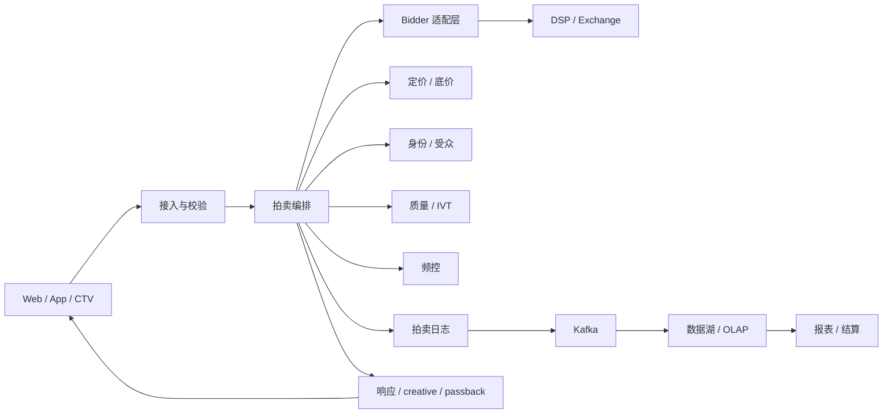
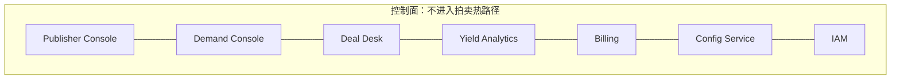

# SSP 平台设计：能力模型、参考架构与平台对比

> 版本：v0.1 ｜ 更新：2026-10-21 ｜ 定位：广告 SSP 的行业设计与平台研究，不构成投放或投资建议。
>
> 口径说明：平台规模数字多为公司官方口径，未经独立审计；产品与策略会持续变化，引用前请核对官方最新文档。文中“SSP”指广告供给方平台（Supply-Side Platform）。

## 一页纸结论

- **SSP 的本质是“拍卖 + 账本 + 信任”**，不是“接了多少 DSP”的功能清单。
- **竞争力取决于三件事**：低延迟且可审计的拍卖、足够密的需求出价、能把赢标变成可对账收入。
- **设计顺序**：商业模式 → 能力域 → 架构 → 组织。先堆功能，通常得到“能竞价但不能结算”的系统。
- **四类模式**：一体化 ad server + exchange、独立 SSP/exchange、服务端 header bidding 市场、App 联盟/聚合；另有白牌基础设施。
- **一句话边界**：ad server 决定“谁有资格进入拍卖”，SSP/exchange 决定“怎么拍”，network/mediation 决定“需求是谁的”。

## 目录

1. [结论与边界](#1-结论与边界)
2. [能力模型：八个域](#2-能力模型八个域)
3. [参考架构](#3-参考架构)
4. [七个关键设计决策](#4-七个关键设计决策)
5. [当前平台是怎么设计的](#5-当前平台是怎么设计的)
6. [2025–2026 的五个变化](#6-20252026-的五个变化)
7. [落地路线图](#7-落地路线图)
8. [常见坑](#8-常见坑)
9. [评价指标](#9-评价指标)
10. [术语表](#10-术语表)
11. [参考资料](#11-参考资料)

---

## 1. 结论与边界

先给结论：**SSP 的竞争力不在功能清单，而在三件事——低延迟且可审计的拍卖、足够密的需求出价、能把赢标变成可对账的收入。** 功能可以照抄，这三件事不能。

设计时先选商业模式，再定能力域和架构。当前平台大致分四类：

1. **一体化 ad server + exchange**：Google Ad Manager、Microsoft Monetize、FreeWheel、Magnite SpringServe。
2. **独立 SSP/exchange**：Magnite DV+、PubMatic、Index Exchange、OpenX、Equativ。
3. **服务端 header bidding 市场**：Amazon TAM、Prebid Server。
4. **App 联盟/聚合**：Pangle/穿山甲、优量汇、AppLovin MAX、ironSource LevelPlay。

另有 **白牌基础设施**（如 Teqblaze），提供可授权的 SSP/DSP/exchange/ad server 软件。

### 1.1 六个角色不能混

| 角色 | 核心职责 | 典型平台 | 关键点 |
|---|---|---|---|
| Ad server | 投放、排期、频控、竞争分离、计量 | Google Ad Manager、FreeWheel、SpringServe | 直接订单的系统 of record |
| SSP | 代表供给方管理库存、接需求、定价、报表、结算 | Magnite、PubMatic、Index Exchange | 通常内置 exchange |
| Ad exchange | 拍卖规则与清算场所 | Google AdX、OpenX | 与 SSP 已高度融合 |
| Ad network | 聚合或买断库存，用自己的需求售卖 | Pangle/穿山甲、优量汇 | 赚差价，不是中立拍卖 |
| Mediation | App 内聚合多个广告网络/需求源 | AppLovin MAX、LevelPlay、GroMore | SDK 层做瀑布流/竞价 |
| Header bidding / Open Bidding | 让多个需求源在 ad server 之外或之内竞争 | Prebid、Open Bidding、TAM | 是机制，不是商业角色 |

一句话：**ad server 决定“谁有资格进入拍卖”，SSP/exchange 决定“怎么拍”，network/mediation 决定“需求是谁的”。**

这个区分直接决定架构。如果你不控制 ad server，通常只能作为 header bidding 或 Open Bidding 中的一个需求来源，把赢家通过 passback 交给别人的 ad server；如果你控制 ad server，才能把 direct sold、PG、PMP、open auction 放进同一套优先级和统一拍卖。Google、Microsoft、FreeWheel 都是后者；Index Exchange、OpenX 是前者的代表。

另一个常见混淆：国内常把穿山甲、优量汇叫 SSP，严格说它们更接近“联盟 + 聚合 SDK”。它们既组织供给，也拥有或组织需求，收入来自差价/分成，不是中立拍卖。用中立 SSP 的架构去套联盟，会低估需求运营和 SDK 分发的权重。

### 1.2 一个关键判断：SSP 与 exchange 已融合

历史上，SSP 是 publisher 的库存管理与收益优化工具，exchange 是买方与卖方相遇的拍卖场所。今天两者高度融合：多数 SSP 内置 exchange，多数 exchange 提供 SSP 式的 publisher 工具。严格区分主要出现在监管、竞争分析和采购尽调中。

对架构真正重要的不是名字，而是三个边界：

- **是否控制 ad server**：决定统一拍卖还是 passback。
- **是否拥有需求**：决定中立拍卖还是 managed/curated。
- **是否控制 SDK/终端**：决定 App 侧的竞价与归因能力。

---

## 2. 能力模型：八个域

| 能力域 | MVP 必须具备 | 规模化后 | 差异化 |
|---|---|---|---|
| 1. 供给接入与库存 | Web/App/CTV 接入；oRTB、VAST、SDK；站点/应用/广告位；ads.txt/app-ads.txt | CTV/DOOH/audio；库存预测；广告位打包 | 终端/OS 级库存、独家格式、第一方数据 |
| 2. 交易与 deal | 开放拍卖、底价、deal ID；基础 PMP | PG、优先 deal、auction package、deal sync | curation marketplace、买方定制 deal |
| 3. 需求接入 | 3–5 家 DSP/exchange adapter；oRTB endpoint；超时/熔断；币种 | 20+ 需求方；QPS 分层；log-level data | 买方自助、容器化决策 |
| 4. 拍卖与定价 | 统一拍卖；第一价 + floor；净价比较；bid 校验 | 动态 floor、traffic shaping、价格规则、A/B | AI 定价、多目标收益优化 |
| 5. 身份、数据、受众 | consent 解析；基础频控；contextual | UID2/EUID、第一方数据、seller-defined audiences、clean room | 跨端身份图、零售/行业数据 |
| 6. 质量、透明、合规 | IVT 检测；creative review；blocklist；ads.txt/sellers.json/schain | 品牌安全、MFA 识别、viewability、MRC 认证 | 可审计供应链、认证与保险 |
| 7. 计量、结算、运营 | impression log；报表；差异对账；账单/付款 | log-level data、归因、自助 console、RBAC | 实时结算、透明费率 |
| 8. 工程底座 | 多 AZ；p99 监控；配置版本化；限流/安全 | 多区域、容灾、成本优化 | 容器/agent 运行时、极致单位成本 |

### 2.1 供给接入与库存

需要支持 Web、App、CTV、音频、DOOH 等形态，并把库存抽象成统一层级：

`publisher → site/app → placement → ad unit/format → impression`

关键能力：

- Web：GPT/Prebid.js、oRTB、passback。
- App：SDK、app-ads.txt、设备标识、consent、bidding/mediation。
- CTV：VAST/VMAP、ad pod、直接订单、频控、竞争分离。
- 库存预测：按站点/广告位/地域/设备/时段预测可售量，支撑 PG 和 forecasting。
- 授权与身份：ads.txt/app-ads.txt 声明授权卖方；sellers.json 声明卖方身份；schain 声明转售链路。

### 2.2 交易与 deal

开放拍卖只是其中一种交易方式。完整的交易能力包括：

- Open auction：公开竞价，价格发现。
- PMP：私有市场，deal ID + 定向 + 底价。
- PG：程序化保证，保量交付，需要预测、优先级和 pacing。
- Preferred deal：优先购买权，未成交再进入开放拍卖。
- Auction package / curated marketplace：把库存、数据、格式打包成可交易的“商品”。
- Deal sync：与 DSP/买方同步 deal 元数据，减少人工配置和错配。

交易层最重要的不是“支持多少种 deal 类型”，而是**优先级和冲突解决**：PG 保量、PMP 底价、open auction、direct line item 同时命中时，谁先谁后，必须有确定性规则并可审计。

### 2.3 需求接入

需求接入不是“多接几家 DSP”，而是管理一个**有预算、有 QPS 上限、有超时、有质量差异**的需求池：

- Adapter 层：协议转换、鉴权、币种、deal 映射、错误码。
- 连接管理：长连接/连接池、QPS 配额、并发上限、熔断、重试策略。
- 超时预算：每个 bidder 独立超时，慢 bidder 不能拖垮整体 p99。
- 分层路由：高价值 impression 才发给高成本/高延迟需求；低价值流量走轻量路径。
- Log-level data：向买方提供 auction/bid 明细，支撑 SPO 和信任。

### 2.4 拍卖与定价

核心能力：

- 统一拍卖：direct、PG、PMP、open auction、第三方 exchange 在同一规则下竞争。
- 价格类型：第一价/第二价；`at` 字段；净价比较；币种归一。
- 底价：placement/geo/device/format 维度；reserve price；动态 floor。
- 价格规则：UPR、价格分层、买方/卖方费率、最低可接受价。
- Bid 校验：价格合法性、deal ID、creative 审核、category 屏蔽、IVT、频控。
- 赢家确定：净价 + 优先级 + 质量约束；记录赢败原因。
- 实验：A/B、holdout、floor 实验、需求路由实验。

### 2.5 身份、数据、受众

- Consent：TCF/GPP 解析，GDPR/CCPA/PIPL/COPPA 等区域规则。
- 身份：UID2/EUID、第一方 ID、设备 ID、household ID；identity-agnostic。
- 上下文：页面/内容/应用分类、关键词、内容分级。
- 受众：第一方数据、seller-defined audiences、数据伙伴、clean room。
- 频控：用户/设备/家庭维度；无 cookie 环境下的替代方案。
- 数据治理：最小化、保留期、区域驻留、访问审计。

### 2.6 质量、透明、合规

这是 SSP 的“准入门槛”，不是可选项：

- 授权与链路：ads.txt/app-ads.txt、sellers.json、schain。
- 流量质量：IVT 检测、pre-bid 过滤、post-bid 监测。
- 创意质量：creative review、malware 扫描、category 审核。
- 品牌安全：blocklist、内容分类、竞争分离、敏感话题。
- 供给质量：MFA（made-for-advertising）识别、低质域名/应用过滤。
- 测量：viewability、可见曝光、无效流量口径。
- 合规：consent、儿童流量、数据出境、广告标识、区域法规。

### 2.7 计量、结算、运营

- 事件采集：impression、click、VAST 事件、viewability、error。
- 日志：幂等 impression ID、去重、采样、分层存储。
- 报表：publisher、demand partner、deal、placement、geo、device 维度。
- 对账：与 ad server、DSP、第三方监测的差异分析。
- 结算：gross/net、take rate、币种、汇率、发票、付款、坏账、退款。
- 运营：publisher 自助、demand 自助、deal desk、yield analytics、告警、RBAC。

### 2.8 工程底座

- 控制面/数据面分离：UI、数据库、报表不进入拍卖热路径。
- 多 AZ/多区域：故障隔离、容量预留、灾备。
- 配置：版本化、灰度、回滚、按 publisher/placement 生效。
- 可观测性：p99、错误率、每 bidder 延迟、赢败原因、成本。
- 安全：请求签名、mTLS、限流、DDoS、PII 脱敏、审计。
- 成本：每百万 bid 的计算/带宽/存储成本；采样与分层存储。

---

## 3. 参考架构

### 3.1 数据面

### 3.2 控制面

### 3.3 一次请求的典型路径

1. **接入校验**：校验 publisher/site/placement、格式、consent、ads.txt/schain、请求签名。
2. **上下文增强**：身份、受众、contextual、底价、IVT 分数、频控。能预计算的全部预计算。
3. **构造 bid request**：按需求方拆分，写入 deal、floor、`tmax`、币种、schain、eids。
4. **并行询价**：每个 bidder 独立超时、独立熔断、独立 QPS 配额；慢 bidder 不能拖垮整体。
5. **bid 校验**：价格合法性、币种、deal ID、creative 审核状态、category 屏蔽、IVT、频控。
6. **统一拍卖**：按净价比较，处理 direct/PG/PMP/open 的优先级，选赢家并记录原因。
7. **返回与曝光**：返回 creative 或 passback，触发 impression/VAST 事件。
8. **异步落账**：拍卖记录、计费事件、报表、模型更新全部异步，不阻塞响应。

### 3.4 延迟预算

以下为建议起点，不是行业常数；实际要按格式、合同和客户端超时调整。

| 阶段 | 建议预算 | 设计要点 |
|---|---|---|
| 接入/校验 | 5–10ms | 本地缓存 publisher/placement 配置 |
| 上下文增强 | 10–30ms | 身份/受众/质量可预计算或并行 |
| Bidder fan-out | 80–150ms | 并行、独立超时、熔断 |
| 拍卖/定价 | 5–10ms | 纯内存规则，不查库 |
| 响应/creative | 5–10ms | 预留 20–30ms 给网络 |
| 总 p99 | 200–300ms（display）；400–600ms（video/CTV） | 按合同和格式调整 |

三个原则：

- **超时层级**：客户端超时 > SSP 总超时 > 单 bidder 超时；先留响应预算，再分配增强和 fan-out。
- **热路径只做必要决策**：身份、受众、质量、定价尽量预计算；日志、报表、模型更新全部异步。
- **可降级**：floor 服务挂了用缓存价；identity 服务挂了走 contextual；bidder 超时/错误熔断；日志写失败本地缓冲；最差返回 passback，不返回错误广告。

### 3.5 三个核心数据模型

1. **库存层级**：publisher → site/app → placement → ad unit/format → impression。
2. **拍卖记录**：request ID、config version、每个 bid 的原始/归一化价格、floor、质量决策、赢家与原因。要能 replay。
3. **结算账本**：impression → 应收/应付 → 账单 → 付款。幂等 ID、去重、对账、差异处理。

再加一个**配置版本**：floor、blocklist、deal 规则每次变更都要版本化、灰度、可回滚；拍卖日志必须带 config version，否则无法解释“为什么这个 bid 赢了”。

---

## 4. 七个关键设计决策

### 4.1 是否自建 ad server？

如果你要做 direct sold、PG、CTV 或自有媒体库存，ad server 是战略资产；如果只是做开放 exchange，优先集成 GAM/FreeWheel/SpringServe，不要把团队耗在排期、频控、竞销分离上。

控制 ad server 才能做统一拍卖；不控制，就接受 passback 和“别人拍卖里的一个候选来源”的位置。

### 4.2 开放还是封闭？

开放 exchange 需要透明度（ads.txt、sellers.json、schain、log-level data）和足够多的第三方需求；封闭联盟更容易做高需求密度和毛利，但买方会质疑你既当裁判又当运动员。

**不要假装中立**：如果你拥有需求，就在产品上明确“managed/curated”，用可审计的拍卖记录证明规则一致。

### 4.3 客户端还是服务端 header bidding？

- 客户端（Prebid.js）：cookie 访问和透明度更好，但延迟和页面性能差。
- 服务端（Prebid Server、Open Bidding、TAM）：延迟低、可控，但 cookie 匹配和透明度要另做。
- 常见做法：服务端为主，客户端 wrapper 保留关键需求；混合架构。

### 4.4 第一价还是第二价？

第一价 + floor 是当前主流；第二价更接近理论上的 truthful bidding，但在 header bidding 和多层转售下容易被套利。

无论选哪种，拍卖比较必须用**净价**（扣除费用后的可比价格），并明确 `at` 字段、币种和结算口径。

### 4.5 自建、Prebid 还是白牌？

- **Prebid Server**：成熟的拍卖内核和 230+ adapter，Apache-2.0，适合 MVP；但没有计费、合同、console、quality、运营后台。
- **白牌**（如 Teqblaze）：能 2–4 周上线，但差异化在需求、数据、定价和运营，软件本身不构成壁垒。
- **自建**：适合有明确差异化（CTV 规则、终端数据、封闭需求）的团队；否则先别从零写 auction。

### 4.6 身份策略怎么定？

2025 年 10 月 Google 退役了 PAAPI、Topics、Attribution Reporting 等 Privacy Sandbox 技术，只保留 CHIPS、FedCM、Private State Tokens；2025 年 4 月也已放弃第三方 cookie 淘汰计划。结论是：**没有浏览器级统一替代**。

SSP 要做 identity-agnostic：UID2/EUID、第一方数据、contextual、seller-defined audiences、clean room 都支持，但不要把某一种 ID 写死。

### 4.7 透明度和利益冲突怎么处理？

买方越来越用 SPO 绕开“多跳、低透明”的路径。SSP 要么证明自己是最短路径（直接合同、低费率、log-level data），要么提供不可替代的 curation/数据。

既收买方钱又收卖方钱、还不披露费率结构的模式，长期会被优质需求排除。

---

## 5. 当前平台是怎么设计的

### 5.1 平台类型对比

| 类型 | 代表 | 适合谁 | 设计要点 |
|---|---|---|---|
| 一体化 ad server + exchange | Google Ad Manager、Microsoft Monetize、FreeWheel、Magnite SpringServe | 有 direct sold、PG、CTV 或自有库存 | ad server 是系统 of record；direct + programmatic 统一拍卖 |
| 独立 SSP/exchange | Magnite DV+、PubMatic、Index Exchange、OpenX、Equativ | 有差异化供给或需求关系 | 不自建 ad server；靠 header bidding/oRTB、yield、curation、SPO |
| 服务端 header bidding 市场 | Amazon TAM、Prebid Server | publisher 保留自己的 ad server | 一次调用、并行询价、统一拍卖、赢家交给 ad server |
| App 联盟/聚合 | Pangle/穿山甲、优量汇、AppLovin MAX、ironSource LevelPlay | 有 SDK/终端或强需求 | SDK + mediation + 自有需求/ADX；瀑布流/竞价 |
| 白牌基础设施 | Teqblaze 等 | 想快速验证/上线 | 授权多租户平台；差异化靠需求/数据/运营 |

### 5.2 Google Ad Manager：一体化模式的参考实现

一个 ad request 进入 GAM，direct line item 走 dynamic allocation，yield group 把请求发给第三方 exchange/SSP，AdX 与 Open Bidding 的净出价和 direct 一起做统一第一价拍卖；UPR 设底价，2019 年起取消 last look。

**设计启示**：控制 ad server 才能做真正的统一拍卖；代价是既当裁判又当运动员，透明度和自我优待的争议会长期存在。

**注意**：Google 在 2025 年 10 月退役了 PAAPI、Topics、Attribution Reporting 等 Privacy Sandbox 技术，SSP 不能把身份和测量策略押在浏览器 API 上。

### 5.3 Microsoft Monetize：ad server + SSP + 开放 Prebid

Microsoft Monetize 是“ad server + SSP”的组合：impression bus 做 bid 评估，Prebid Server Premium 基于开源 PBS Go 接入大量需求，支持 PMP/PG 和 publisher controls。

**设计启示**：用开源做需求接入，用自有 ad server 做系统 of record，是“开放生态 + 自有控制点”的折中。

### 5.4 FreeWheel：CTV 垂直化

FreeWheel 的 Streaming Hub 是 ad server，集成 SSP，核心不是开放 auction，而是 TV 业务规则——ad pod、竞争分离、频控、dayparting、direct + programmatic 统一决策，另有 identity network 和 dynamic floor。

**设计启示**：CTV 的壁垒在业务规则和直接订单，不在 bidder 数量。

### 5.5 Magnite：模块化独立 SSP

Magnite 走模块化路线：

- **SpringServe**：CTV ad server + SSP。
- **DV+**：display/video/audio/native/DOOH SSP。
- **Access**：identity/audience。
- **ClearLine/Showcase**：curation 和买方直达。
- **Demand Manager**：header bidding。

Magnite 也是 Prebid 的联合创始方。**设计启示**：不追求单一巨系统，用模块覆盖 sell-side 全链路，靠 CTV + curation 做差异化。

### 5.6 PubMatic：单一云原生平台 + SPO

PubMatic 的产品组合包括：

- **OpenWrap**：header bidding。
- **Connect**：curation/data。
- **Activate**：让买家在平台上执行 non-bidded direct deals（SPO）。
- **Intelligent Yield**：定价优化。

一套代码和数据底座，强调单位成本。**设计启示**：供给接入不再稀缺，SSP 要用 SPO、curation、买方直达和成本效率竞争。

### 5.7 Index Exchange：exchange-only

Index Exchange 不把 ad server 作为核心，Index Cloud 把决策放在离 impression 更近的地方，Index Marketplaces 做 sell-side curation，强调中立和透明。

**设计启示**：中立交易所可以和 ad server 共存，靠低延迟、透明和 curation 取胜。

### 5.8 OpenX：可编程 exchange

OpenX 在 2026 年初推出 OpenXBuild，把买方自定义决策、身份解析、拍卖洞察以 API 放进 exchange，买家可以在拍卖前跑自己的模型；方向与 IAB Tech Lab 的 Agentic RTF 容器化一致。

**设计启示**：SSP 正在从“转发请求”变成“可编程交易基础设施”，扩展性会成为下一个差异化。

### 5.9 Amazon TAM：服务端 header bidding 市场

Amazon TAM 不是单一 SSP，而是服务端 header bidding 市场：页面/App 一次调用，云端并行询问 50+ 买家，统一第一价，提供拍卖级报表，向买方收 2.5% 服务费；TAM 由 publisher 与各 SSP 直签，UAM 则由 Amazon 统一合同和付款。

**设计启示**：用“一次集成 + 透明拍卖”聚合需求，publisher 保留自己的 ad server。

### 5.10 Prebid：开源基础设施

Prebid 不是商业 SSP：

- **Prebid.js**：客户端 header bidding。
- **Prebid Server**：Go/Java 服务端 auction，Apache-2.0，230+ adapter。
- **Prebid Mobile**：App 端。

支持 stored request、隐私、货币换算、VAST/creative cache；但没有计费、合同、运营后台。

**设计启示**：把 Prebid 当拍卖内核和 adapter 生态，商业层（定价、结算、console、quality）自建。

### 5.11 Pangle/穿山甲：App 联盟

Pangle/穿山甲是 App 变现网络：SDK + 多种广告样式 + GroMore 聚合（接第三方 ADN、自定义 ADN、ADX）+ 自有需求。官方口径为 10 万+ App、8 亿+ DAU、620 亿+ 日请求。

**设计启示**：这是“SDK + mediation + owned demand”的联盟模型，优势是需求密度和接入速度，代价是开放性和透明度。

### 5.12 优量汇：腾讯系 App 联盟

优量汇是腾讯系 App 联盟：SDK + 开屏/激励/信息流/插屏/Banner + 聚合平台 + Bidding/瀑布流。官方口径为 10 万+ App、10 亿+ 月覆盖、65 亿日曝光。

**设计启示**：国内更常见的是“联盟 + 聚合 + 竞价”，需求集中在少数大平台，纯开放 SSP 的生存空间取决于差异化供给和数据。

### 5.13 Teqblaze：白牌路线

Teqblaze 提供白牌 SSP/DSP/exchange/ad server 模块、SmartFloor、traffic shaping、SPO toolkit、curated deals UI；厂商称 2–4 周上线、60+ 客户。

**设计启示**：如果目标是快速验证，白牌/托管 Prebid 可以省 6–12 个月；但要谈清数据所有权、源码/退出条款、需求接入是否独立。

---

## 6. 2025–2026 的五个变化

### 6.1 Privacy Sandbox 退场

2025 年 10 月 17 日，Google 宣布退役 PAAPI、Topics、Attribution Reporting 等 10 项 Privacy Sandbox 技术，只保留 CHIPS、FedCM、Private State Tokens；2025 年 4 月已放弃第三方 cookie 淘汰计划。

影响：SSP 不能再把身份和测量押在浏览器 API 上。第一方数据、contextual、UID2/EUID、clean room 会长期并存；测量责任更多回到广告主和行业标准组织。

### 6.2 SPO 和 curation 成为主战场

买方不再缺供给接入，缺的是“更短路径 + 更好的数据 + 可验证质量”。PubMatic Activate、Index Marketplaces、Magnite ClearLine/Showcase、OpenXSelect 都是这个方向。

SSP 的能力重心从“接需求”转向“帮买方做选择”。

### 6.3 CTV/streaming 继续吸金

ad pod、household identity、direct + programmatic 统一决策、动态 floor 是重点。CTV 的延迟容忍度比 display 高，但业务规则更复杂，FreeWheel/Magnite/PubMatic 都在这里建立差异化。

### 6.4 Agentic/容器化开始落地

IAB Tech Lab 的 Agentic RTF 在 2025 年 11 月开放公共评论，2026 年推进 v1/v2；OpenXBuild 已经把买方模型放进 exchange。

SSP 需要预留容器沙箱、资源配额、无外网、审计和计费，否则“可编程”会变成 SLA 和安全的灾难。

### 6.5 质量与透明成为准入门槛

ads.txt/app-ads.txt、sellers.json、schain 已是基础；IVT、MFA、品牌安全、viewability 决定买方是否把你放进“durable supply chain”。

没有这些，价格再低也会被 SPO 掉。

---

## 7. 落地路线图

| 阶段 | 时间 | 目标 | 关键交付 |
|---|---|---|---|
| 0. 定义 | 0–2 个月 | 选模式、格式、区域、需求 | 商业模式/单位经济；build vs buy；3–5 家需求意向 |
| 1. MVP | 2–6 个月 | 跑通一次可对账的交易 | 一个格式、一个供给渠道、3–5 家需求、oRTB、统一拍卖、floor、consent、ads.txt/schain、日志、报表、账单、publisher console |
| 2. 收益 | 6–12 个月 | 提升 eCPM/填充率 | 动态 floor、traffic shaping、PMP/PG、curation、identity、A/B、log-level data；20+ 需求 |
| 3. 规模化 | 12–24 个月 | 多格式/多区域/低成本 | CTV/audio/DOOH、多区域、容灾、agent 运行时、clean room、单位成本优化 |

### 7.1 MVP 的最小闭环

**一个格式 + 一个供给渠道 + 3 家需求 + 一次统一拍卖 + 一条可对账的 impression log + 一个 publisher 报表。**

先证明这六件事，再谈 AI 定价和 curation。

### 7.2 Build vs buy

- **验证期**：Prebid Server（自托管或托管）+ 自建 console/结算，3–6 个月；不要从零写 auction。
- **规模化**：自建拍卖/定价/数据面，保留 OpenRTB adapter 生态；把差异化放在定价、quality、curation、CTV 规则上。
- **追求速度**：白牌；但必须拿到数据所有权、源码/退出条款、独立需求接入权。
- **不要轻易自建 ad server**，除非 direct sold、PG、CTV 或自有媒体库存是核心。

### 7.3 团队配置

至少要有：auction/backend（Go/Java/Rust）、数据平台、SRE、前端、产品/yield、demand ops、publisher ops、合规。只有销售和 BD 做不成 SSP。

---

## 8. 常见坑

- 把 SSP 做成“竞价 API + 后台”，缺 ad server、deal、结算和对账。
- 先做功能，后做流动性；没有需求密度，拍卖是空的。
- 低估 fan-out 成本：QPS × bidder 数 × 区域，带宽和 p99 会一起爆。
- 结算后置：日志丢失、重复、差异、坏账，最后收入对不上。
- 透明度和商业模式冲突：既做裁判又做运动员，还不披露规则。
- 合规后置：consent、儿童流量、数据出境、PIPL/广告法。
- 只做 open auction：PMP/PG/curation 才是收入大头。
- 不做质量：IVT/MFA 会让优质买方直接把你 SPO 掉。
- 盲目自建：Prebid/白牌先验证，再决定自研边界。

---

## 9. 评价指标

| 维度 | 关键指标 |
|---|---|
| 商业 | revenue、RPM/eCPM、fill rate、take rate、net revenue、publisher retention |
| 拍卖健康 | bid rate、win rate、bid density、timeout rate、floor pass rate、unsold rate |
| 质量 | IVT rate、viewability、brand safety incidents、MFA share、discrepancy |
| 工程 | p99 latency、availability、error rate、config propagation、cost per 1M bids |

一句话总结：**SSP 是“拍卖 + 账本 + 信任”三件事的组合；平台 survey 里的所有设计，最后都可以归到这三件事上。**

---

## 10. 术语表

| 术语 | 含义 |
|---|---|
| SSP | Supply-Side Platform，供给方平台，代表 publisher 管理库存和需求 |
| DSP | Demand-Side Platform，需求方平台，代表广告主购买流量 |
| Ad server | 广告投放与计量系统，管理排期、频控、竞争分离、直接订单 |
| Ad exchange | 广告交易市场，运行实时竞价 |
| Ad network | 聚合或买断库存，用自有需求售卖，赚差价 |
| Mediation | App 内聚合多个广告网络/需求源的 SDK 层 |
| Header bidding | 在 ad server 之外先向多个需求源询价，再把最高价传给 ad server |
| Open Bidding | ad server 内部的服务端统一拍卖，第三方 exchange/SSP 与自有需求同场竞争 |
| PMP | Private Marketplace，私有市场，通过 deal ID 交易 |
| PG | Programmatic Guaranteed，程序化保证，保量交付 |
| SPO | Supply Path Optimization，供给路径优化，减少中间跳数和低效路径 |
| Curation | 在供给侧把库存、数据、格式打包成更有针对性的商品 |
| IVT | Invalid Traffic，无效流量 |
| MFA | Made for Advertising，为广告而生、体验/内容质量低的站点或应用 |
| ads.txt |  publisher 声明授权卖方的文件 |
| sellers.json | 卖方/中间方身份声明文件 |
| schain | SupplyChain object，声明一笔请求经过的所有卖方节点 |
| TCF | IAB Europe 的 Transparency & Consent Framework |
| GPP | IAB Tech Lab 的 Global Privacy Platform |
| UID2 | Unified ID 2.0，基于加密邮箱/手机号的开放身份方案 |

---

## 11. 参考资料

### 规范与标准

- [IAB Tech Lab OpenRTB](https://iabtechlab.com/standards/openrtb/)
- [IAB Tech Lab ads.txt](https://iabtechlab.com/ads-txt/)
- [IAB Tech Lab sellers.json / SupplyChain](https://iabtechlab.com/sellers-json/)
- [IAB Tech Lab Agentic RTF](https://iabtechlab.com/standards/artf/)
- [IAB Europe TCF](https://iabeurope.eu/transparency-consent-framework/)
- [IAB Tech Lab GPP](https://iabtechlab.com/standards/global-privacy-platform/)
- [Google Privacy Sandbox 退役公告](https://privacysandbox.google.com/blog/update-on-plans-for-privacy-sandbox-technologies)
- [Unified ID 2.0](https://unifiedid.com/)

### 平台官方资料

- [Google Ad Manager: How Open Bidding works](https://support.google.com/admanager/answer/7128958)
- [Google Unified First Price Auction Best Practices](https://services.google.com/fh/files/misc/unified_first-price_auction_best_practices.pdf)
- [Microsoft Monetize 文档](https://learn.microsoft.com/en-us/xandr/monetize/)
- [Microsoft Prebid Server Premium](https://learn.microsoft.com/en-us/xandr/monetize/set-up-prebid-server-premium)
- [FreeWheel Streaming Hub](https://www.freewheel.com/streaming-hub)
- [Magnite sellers](https://www.magnite.com/sellers/)
- [PubMatic Activate 发布](https://investors.pubmatic.com/news-releases/news-release-details/pubmatic-launches-activate-bringing-programmatic-automation)
- [Index Exchange](https://www.indexexchange.com/)
- [OpenX](https://www.openx.com/)
- [Amazon Transparent Ad Marketplace](https://aps.amazon.com/aps/transparent-ad-marketplace/)
- [Prebid Server 概览](https://docs.prebid.org/prebid-server/overview/prebid-server-overview.html)
- [Prebid Server GitHub](https://github.com/prebid/prebid-server)
- [Pangle](https://www.pangleglobal.com/)
- [穿山甲](https://www.csjplatform.com/)
- [优量汇](https://e.qq.com/dev/index.html)
- [Teqblaze White Label SSP](https://www.teqblaze.com/white-label-ssp)

### 行业研究

- [Jounce Media](https://jouncemedia.com/)

---

## 版本记录

| 版本 | 日期 | 说明 |
|---|---|---|
| v0.1 | 2026-10-21 | 初稿：结论、八域能力、参考架构、平台对比、路线图 |
